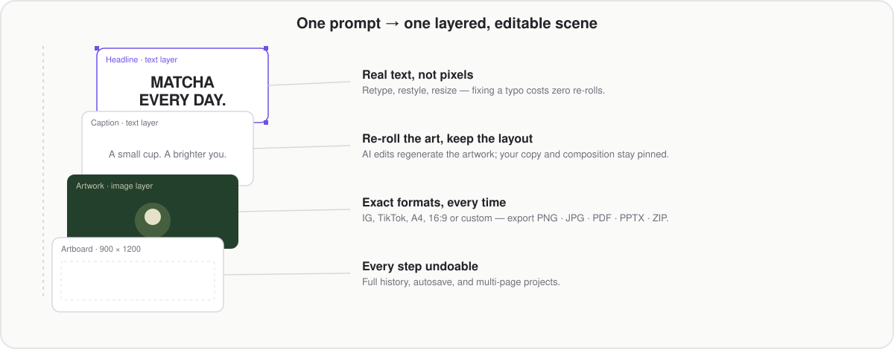

<p align="center">
  
</p>

<p align="center">
  <a href="LICENSE"></a>
  
  
  
  
</p>

> **AI image chats hand you pixels. PixForge hands you the design.**

PixForge is an open-source, self-hostable AI visual design studio. An agent composes your design as real, editable layers — then you take over: retype the headline, pin the layout, swap the artwork, stamp your brand, and export to exact formats. Your keys. Your server. Your data.

<p align="center">
  
</p>

## The re-roll tax

Every image-model re-roll is a dice roll. Fix one typo and the whole composition changes. Brand colors drift page to page. The output is one flat image in one fixed ratio — so real design work degenerates into prompting, praying, and regenerating.

PixForge removes the tax: **generation ends in an editable scene, not a flattened PNG.**

```
prompt → planner (LLM) → artwork (your provider) → layered Fabric scene → your edits → PNG · JPG · PDF · PPTX · ZIP
```

<p align="center">
  
</p>

**What "editable" means in practice:**

- **Text is real text.** Click the headline and retype it — font, weight, color, spacing, alignment. No re-generation, no cost, no drift.
- **Layout is yours.** Move, rotate, reorder, duplicate, or delete any layer. Add headings, shapes, tables, drawings, your logo. Snap the artboard to IG, TikTok, A4, 16:9, or custom pixels.
- **AI edits are surgical.** Select a layer, say what to change — the agent regenerates the artwork while your copy and composition stay pinned. The old state stays in undo.
- **Every format, one click.** PNG · JPG · PDF (mixed page sizes) · PPTX · ZIP.

## vs. a plain image chat

| | Image chat (e.g. ChatGPT) | PixForge |
| --- | --- | --- |
| Fix a typo | re-roll the whole image | edit the text layer — free |
| Exact size / format | few fixed ratios, image only | any artboard + PNG/JPG/PDF/PPTX/ZIP |
| Multi-page series | prompt page by page, style drifts | one prompt → up to 9 coherent pages in one project |
| Brand consistency | re-describe the brand every time | Brand Kit injects colors, fonts, guidance automatically |
| Mistakes | no undo | full undo/redo history + autosave |
| Reuse | keep prompts (hope they hold) | publish templates as editable scene JSON |
| Automation | manual chatting | HTTP API + agent skills (Claude Code, Codex, Cursor, Gemini CLI) |
| Models | locked to one vendor | BYOK: codex · openai · fal · replicate · comfyui · mock |

## Built for real work

- **Multi-page projects** — duplicate, resize, and reorder pages; each keeps its own artboard.
- **Brand Kit** — logos, colors, fonts, and guidance applied to every generation.
- **Community templates** — share a design as a fully editable scene, not a JPEG.
- **Toolbox** — converters, resizer, charts, AI editor, Xiaohongshu/RED carousel creator.
- **For agents** — API keys, task polling, chunked upload, and installable `SKILL.md` skills.

## Bring your own keys

Copy `.env.example` to `.env` — leave it blank for the offline mock provider.

| Variable | Options |
| --- | --- |
| `IMAGE_PROVIDER` | `mock` (default) · `codex` · `openai` · `fal` · `replicate` · `comfyui` |
| `LLM_PROVIDER` | `mock` (default) · `openai` · `openrouter` · `ollama` |

**No API key at all?** Run `codex login` once (Sign in with ChatGPT), set `IMAGE_PROVIDER=codex` — generation runs through the Codex CLI's `$imagegen` on your existing plan quota.

## Quick start

```bash
pnpm install
pnpm dev            # http://localhost:3100 — mock provider, no keys needed
```

Optional worker and tests:

```bash
docker compose -f docker/docker-compose.yml up -d redis
REDIS_URL=redis://localhost:6379 pnpm --filter @pixforge/worker dev   # background tasks

pnpm build && pnpm typecheck
REDIS_URL=redis://localhost:6379 pnpm test                            # 152 tests
```

### Self-host API

```bash
# Create a key at http://localhost:3100/for-agents
curl -X POST localhost:3100/api/tasks/generate-poster \
  -H 'content-type: application/json' \
  -d '{"prompt":"pastel coffee poster","noWait":true}'
```

`{code, data, msg}` envelope · poll `GET /api/tasks/{taskId}` (24h TTL) · chunked upload `chunk-init → chunk → chunk-complete` · set `PIXFORGE_REQUIRE_KEY=1` in production.

<details>
<summary><strong>Monorepo layout</strong></summary>

```
apps/web            Next.js app — studio UI, editor, REST + SSE API
apps/worker         background task worker (BullMQ / in-process)
packages/schema     zod schemas: scene graph, SSE protocol, task types
packages/protocol   SSE decoder + [[task::]]/[[canvas::]] markers + golden fixture
packages/canvas     Fabric wrapper, editor presets, pages, export planner
packages/providers  BYOK adapters: image (mock/codex/openai/fal/…) · llm (mock/openai/…)
packages/agent      designer agent: planner → image tool → progressive canvas events
packages/tasks      task store, queue (BullMQ), processors, uploads, projects, templates
packages/db         drizzle schema (users/sessions/projects/brandkits/templates/api_keys)
packages/skills     SKILL.md agent skills
docker/             postgres + redis + minio compose files
docs/               design direction and verification notes
```

</details>

## Honest limits

- Editing pixels *inside* the artwork still means a provider re-roll (reference-image generation) — PixForge pins everything else around it.
- The `codex` route uses your ChatGPT plan quota; PixForge adds the studio around it, not cheaper generation.
- Background removal needs the `rembg` CLI. PPT Translator is a coming-soon landing page. The interface is English; generation follows your prompt's language.

## License

MIT — see [LICENSE](LICENSE).
