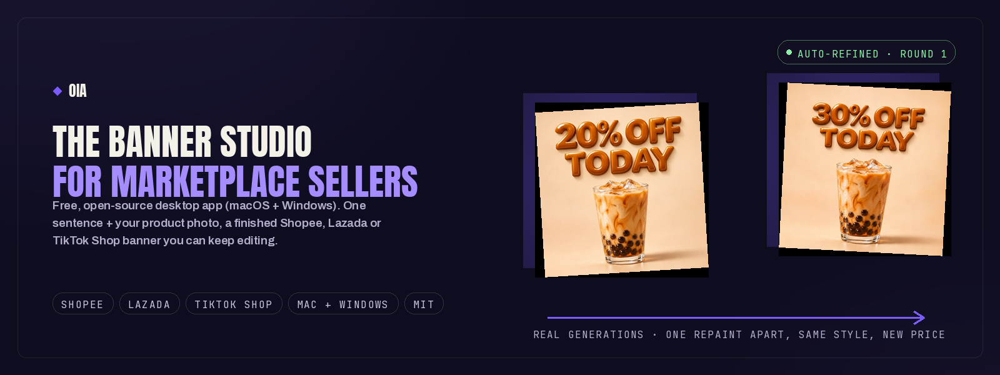
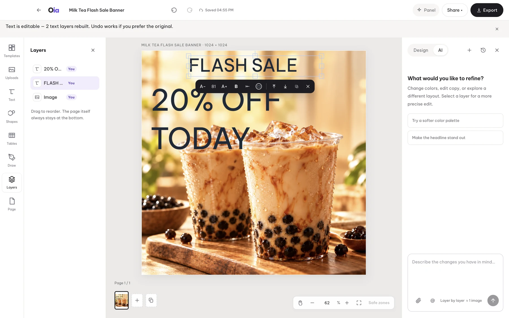
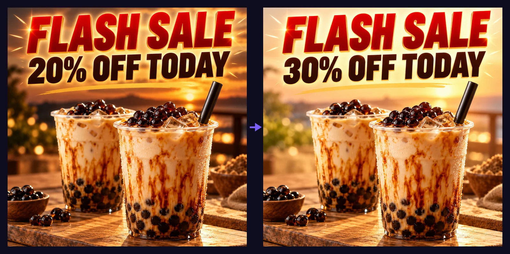
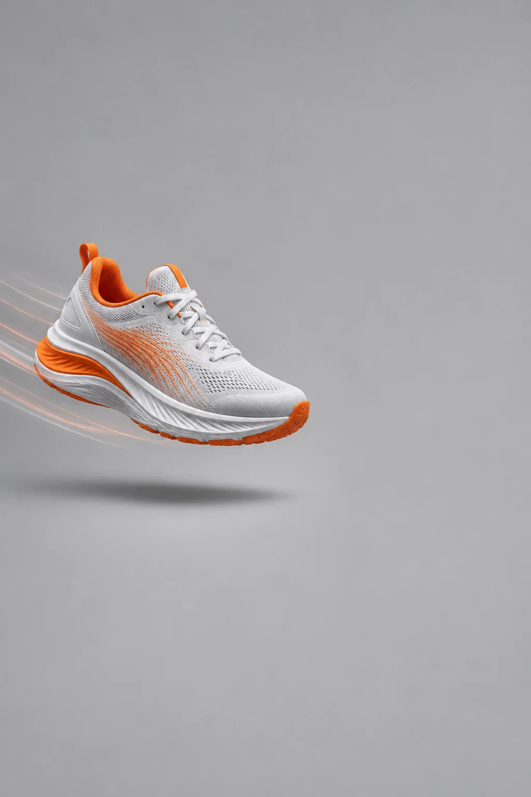
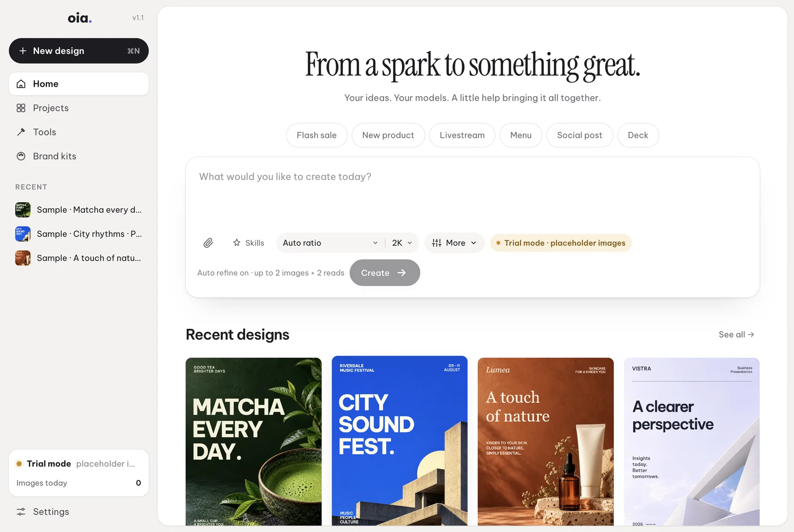
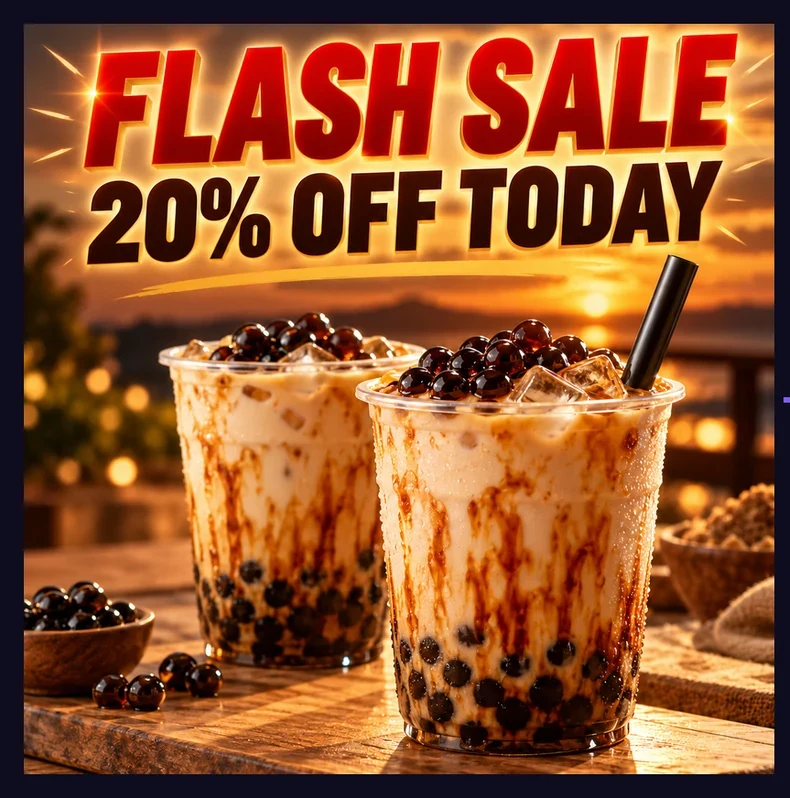

<p align="center">
  
</p>

<p align="center">
  <strong>Generate the image. Keep the control.</strong>
</p>

<p align="center">
  <sub><b>FREE &amp; OPEN SOURCE</b> ◆ <b>MIT</b> ◆ <b>SELF-HOSTED</b> ◆ <b>BYO PROVIDER</b> ◆ <b>MAC + WINDOWS</b></sub>
</p>

<p align="center">
  <a href="https://github.com/cuongducle/oia/releases"></a>
  &nbsp;<a href="LICENSE"></a>
  &nbsp;
  &nbsp;
</p>

<p align="center">
  <a href="#the-60-second-tour">Tour</a> ·
  <a href="#the-image-and-the-design-are-different-things">Layers</a> ·
  <a href="#what-your-quota-buys">Gallery</a> ·
  <a href="#a-studio-around-your-image-model">Workflow</a> ·
  <a href="#quick-start">Quick start</a> ·
  <a href="#bring-your-own-provider">Providers</a> ·
  <a href="#build-it-into-your-workflow">Agent API</a> ·
  <a href="#questions-sellers-ask">FAQ</a> ·
  <a href="https://oia.solutions/">Landing page</a>
</p>

---

A campaign headline changes. An event date moves. A client wants the logo larger. Those are layout and copy edits — not reasons to pay for a whole new image.

**Oia is a free, open-source desktop app (macOS + Windows) that pairs AI image generation with a real, layer-based canvas.** Generate the artwork, then edit the design: rewrite text, move objects, swap images, add pages — without regenerating what already works. Everything runs on your machine, on your own provider, under your control.

<p><sub><b>TOUR</b></sub></p>

## The 60-second tour

<p align="center">
  
  <br><sub><b>The studio.</b> Real editor, real Codex generation — text rendered into the artwork by the image model, then rebuilt as editable layers in one click.</sub>
</p>

<p align="center">
  
  
  
  <br><sub><b>Studio templates.</b> Real generated scenes, published as editable community templates — open one and make it yours.</sub>
</p>

<p><sub><b>LAYERS, NOT MAGIC</b></sub></p>

## The image and the design are different things.

An Oia document is separate canvas objects, not a flat picture:

`text` · `images` · `shapes` · `your uploads` · `layers panel` · `safe zones` · `multi-page` · `undo · autosave`

| Object | What you can change |
| :--- | :--- |
| **Text** | Rewrite copy, adjust size, weight, color, alignment, and spacing |
| **Images** | Move, resize, rotate, reorder, or replace artwork and uploaded assets |
| **Shapes & additions** | Add graphic elements, tables, drawings, and more text |
| **Artboard** | Set document dimensions independently for each page |

Move a native headline without moving the photograph. Fix its wording without calling an image model. Duplicate a page and adapt the copy for another placement.

> **Text in the image, by default (D16).** Generations render the copy into the artwork with the image model's typography (best-looking results). Two paths keep text editable: flip **“Editable text right away”** in the composer before generating (clean-plate artwork + native text layers), or — on any baked design — select the artwork and click **“Make text editable”** (reads the text with your provider, ≈ 1 image + 1 read, rebuilds each line as a layer). Text already embedded in an imported image is pixels until you run the same command.

> **Non-destruction guarantee.** AI refinement never deletes your own layers. Objects you add (uploads, product photos, hand-placed text, tables) are stamped `origin: "user"` and survive every AI refinement on top of the regenerated scene — position intact. Layer objects without provenance (legacy projects) default to the same protection. Removing them is a manual, explicit act.

<p><sub><b>THE PREMIUM FEATURES</b></sub></p>

## What your quota buys.

Every image below is a real generation from a real run — no mockups, no stock. Web research checks current facts before designing; auto refine checks the result against your brief; the full price is shown before you run.

<p align="center">
  
  <br><sub><b>Repaint keeps the style.</b> Same banner, one edit apart.</sub>
</p>

<p align="center">
  
  
  
  <br><sub><b>Real runs.</b> Researched posters, rendered typography, published as editable templates.</sub>
</p>

<p align="center"><strong>0</strong> surprises — every loop is priced before you run it (<code>up to N images + N reads</code>).</p>

<p><sub><b>WORKFLOW</b></sub></p>

## A studio around your image model.

### 01 — Describe it

Describe the visual, choose dimensions and page count, follow the streamed progress. Two agent loops run on top of your provider, both on by default, both remember your choice:

- **Research the web** — the planner looks up current facts (dates, prices, trends) before designing, and shows each finding with its source.
- **Auto refine** — every generated image is checked against the brief — spelling and language of the rendered text first — and re-generated when the critic finds a fixable defect. Bounded and priced up front: `up to N images + N reads`.

Use a supported image provider for real artwork, or explore with the keyless mock provider and bundled templates.

### 02 — Approve the outline

Multi-page plans land as an outline first — see the pages before they're painted. Editing the outline is text-only and costs no images.

### 03 — Make it yours

Edit native objects directly on the Fabric.js canvas: rewrite copy, move and reorder objects, add your own images, work across pages with different dimensions. Change the price → the repaint keeps the style. Preview AI edits first and apply only what you keep. Undo/redo and autosave throughout. Brand Kit stores brand information and passes its written guidance to the generation planner — a prompt aid, not a guarantee that every font, logo, or color will be applied automatically.

### 04 — Produce

Export **PNG, JPG, PDF, PPTX, or a ZIP of page images**. PDF preserves mixed page sizes. PPTX places rendered artwork on slides; it does **not** convert canvas layers into native PowerPoint text and shapes. Marketplace presets (Shopee / Lazada / TikTok Shop), livestream overlays, posters, and 16:9 decks. The Toolbox also brings format conversion, image resizing, chart creation, and provider-backed image tasks.

<p align="center">
  
  <br><sub>real codex run · research → check → refine → <b>auto-refined</b></sub>
</p>

<p align="center">
  <sub><b>no account</b> ◆ <b>local-first</b> ◆ <b>priced up front</b> ◆ <b>export anywhere</b></sub>
</p>

<p><sub><b>TEXT IN IMAGE</b></sub></p>

## Change the price. Keep the style.

Ask for “make it 30% off today” — the repaint re-generates the banner (≈ 1 image) while the design language stays: same glossy typography, same drinks, same lighting.

<table>
  <tr>
    <td align="center" width="50%"><br><sub><b>before · 20% off</b></sub></td>
    <td align="center" width="50%"><br><sub><b>after · 30% off</b></sub></td>
  </tr>
</table>

Need movable letters instead? **“Make text editable”** rebuilds the copy as native layers — ≈ 1 image + 1 read. Or flip **“Editable text right away”** before generating to get clean-plate artwork plus live text objects from the start.

<p><sub><b>SCOPE</b></sub></p>

## When to use this instead of an image chat

**Use an image chat when the image itself is the deliverable. Use Oia when you also need to assemble, revise, and reuse a design.** It adds a workflow around image models — not a claim of a better underlying model.

| Your task | With an image-only result | With Oia |
| :--- | :--- | :--- |
| Change a headline or event date | Edit the image or regenerate it | Edit the native textbox, if the copy is a separate layer |
| Move a logo or adjust a composition | Open a separate editor | Work on canvas objects in the same studio |
| Organize a multi-page project | Manage separate outputs | Keep pages, dimensions, and revisions in one project |
| Reuse a layout | Rebuild it or reuse a flattened image | Save and share an editable scene as a template |
| Deliver files | Convert and assemble them elsewhere | Export images, PDF, PPTX, and ZIP from the editor |
| Automate recurring tasks | Depends on the service and its API | Use the local agent API and coding-agent skills |

## Quick start

**Requirements:** Node.js 22 and pnpm 10. macOS or Windows. No provider key, database, or broker is needed to explore the default local setup.

```bash
git clone https://github.com/cuongducle/oia.git
cd oia
pnpm install

# Build the workspace packages before starting the desktop app.
pnpm exec turbo run build --filter='./packages/*'
pnpm --filter @oia/desktop dev
```

Start with a bundled **Sample** project (seeded on first run) to try real text and object editing. The default mock provider is for testing the workflow; it does not generate production AI artwork.

**Real generations:** the app bundles a pinned Codex CLI binary, so the recommended keyless path is zero-setup — open **Runtime** in the app, sign in with ChatGPT, and generate against your plan quota. No API key required. Alternatively set `IMAGE_PROVIDER`/`LLM_PROVIDER` (see `.env.example`) to use OpenAI or fal keys.

> Installers are not published yet. You can build one yourself — no signing, no notarization. Build each platform on its own OS:
>
> ```bash
> pnpm --filter @oia/desktop dist:mac        # macOS: .dmg (fetches the pinned Codex binary first)
> pnpm --filter @oia/desktop dist:mac:dir     # macOS: quick dist/mac-arm64/Oia.app
> pnpm --filter @oia/desktop dist:win        # Windows: dist/Oia-<version>-win-x64.exe (NSIS, per-user, no admin)
> pnpm --filter @oia/desktop dist:win:dir     # Windows: quick dist/win-unpacked/Oia.exe
> ```
>
> The builds are unsigned (deliberate — no signing budget yet). On macOS, a build **downloaded** from GitHub carries a quarantine flag, so on first open right-click the app → **Open** → **Open** (or System Settings → Privacy & Security → "Open Anyway") to pass Gatekeeper. On Windows, SmartScreen shows "Windows protected your PC" → **More info** → **Run anyway**. The Windows installer puts the app in `%LOCALAPPDATA%\Programs\Oia`; projects live in `%APPDATA%\Oia` and survive uninstall and upgrade. There is no auto-update channel until signing exists — pick up new versions from the releases page.

<p><sub><b>NO LOCK-IN</b></sub></p>

## Bring your own provider

The **provider registry** implements:

| Role | Provider | Setup |
| :--- | :--- | :--- |
| Image | `mock` | Default when no runtime is ready; no credentials (labeled **“Chế độ thử nghiệm”** in the UI) |
| Image | `codex` | Bundled CLI with image generation available and an authenticated ChatGPT login |
| Image | `openai` | `OPENAI_API_KEY` (generations **and** edits with reference images; one pinned model) |
| Image | `fal` | `FAL_KEY` |
| Planner | `mock` | Default; no credentials |
| Planner | `codex` | Same Codex login — text-only `codex exec`, structured plan, no API key |
| Planner | `openai` | `OPENAI_API_KEY` |

A mixed mock/real pair (for example a mock planner feeding the real Codex image channel) **refuses to boot** — canned planner output never rides a real generation channel silently.

For Vietnamese sellers this enables the banner loop end to end: describe the banner in Vietnamese → the planner reads price/date/name out of the request (editable text blocks, font Be Vietnam Pro) → clean-plate artwork (no baked text) is generated through your ChatGPT plan quota → attach the real product photo as a **reference image** (`codex exec -i`) so the scene is built around the actual product → export at marketplace sizes (Shopee / Lazada / TikTok Shop presets).

Codex image generation depends on CLI support and account access, and consumes the applicable account allowance. Other paid providers bill through your own account. **Local does not mean generation is free.** Provider names beyond the implemented registry should not be treated as working integrations.

<p><sub><b>AGENT-READY</b></sub></p>

## Build it into your workflow

The desktop app runs a **loopback agent API** bound to `127.0.0.1` (random port). The port is published in a discovery file `agent-api.json` (mode 0600) under the app's user-data directory (`~/Library/Application Support/Oia` on packaged macOS, `%APPDATA%\Oia` on Windows).

1. Open the app → **For agents** → create an API key (shown once).
2. Point an agent at it — either set `OIA_BASE_URL`/`OIA_API_KEY`, or do nothing: the skill scripts read the discovery file themselves (a stale file whose PID is dead is skipped).

```bash
curl -X POST http://127.0.0.1:<port>/api/tasks/generate-poster \
  -H 'Content-Type: application/json' \
  -H "Authorization: Bearer ${OIA_API_KEY}" \
  -d '{"prompt":"A minimal coffee campaign poster"}'
```

The default submission returns a task ID; poll `GET /api/tasks/{id}` for the result. Responses use a `{code, data, msg}` envelope. Task records have a 24-hour TTL. When the app is closed the server goes away — agents get `ECONNREFUSED`.

Quota is protected: at most one metered generation in flight, per-key rate limits on submissions, and every agent-created job is labeled in the app's job feed so you can see who is spending your quota.

Installable instructions for coding agents live in [`packages/skills/skills`](packages/skills/skills).

<p><sub><b>FAQ</b></sub></p>

## Questions sellers ask.

<details>
<summary><strong>Is Oia really free?</strong></summary>

Yes — MIT-licensed open source. No account, no credits, no subscription. Generations run on your own provider: sign in with ChatGPT through the bundled Codex CLI, or plug in your OpenAI/fal API key. Local does not mean generation is free — your provider's quota and pricing still apply.

</details>

<details>
<summary><strong>Can I edit the text in a generated image?</strong></summary>

By default the copy is rendered <em>into</em> the artwork for the best-looking typography. Change it by asking — “make it 30% off today” — and the repaint keeps the style. Need movable letters instead? Flip <em>Editable text right away</em> before generating, or run <em>Make text editable</em> on any design.

</details>

<details>
<summary><strong>What do Research and Auto refine do?</strong></summary>

Two agent loops that run over your provider. <em>Research the web</em> (on by default where supported) lets the planner look up current facts — dates, prices, trends — before designing, and shows every finding with its source. <em>Auto refine</em> checks each generated image against your brief — spelling and language of the rendered text first — and re-generates when the critic finds a fixable defect. Bounded, and the full price is shown before you run (e.g. <em>up to 2 images + 2 reads</em>). Both switches remember your choice.

</details>

<details>
<summary><strong>Do I need an API key?</strong></summary>

No. The recommended path is zero-setup: open Runtime in the app, sign in with ChatGPT, and generate against your plan quota. Keys are optional (OpenAI, fal).

</details>

<details>
<summary><strong>Mac or Windows?</strong></summary>

Both — native builds for macOS (Apple Silicon) and Windows. Your projects live on your machine.

</details>

<details>
<summary><strong>Where do my designs live?</strong></summary>

On your machine — projects, assets, and conversations are stored locally in the app's data directory. Nothing is uploaded to us (there is no “us” server). Prompts and images used for generation still go to the provider you configure.

</details>

<p><sub><b>OPEN SOURCE</b></sub></p>

## Yours to run. Yours to keep.

<p align="center">
  <sub><b>MIT license</b> ◆ <b>self-hosted</b> ◆ <b>BYO provider</b> ◆ <b>agent-ready</b></sub>
</p>

Oia is released under the [MIT license](LICENSE). Explore the code, adapt the studio to your workflow, and contribute through [issues](https://github.com/cuongducle/oia/issues) or pull requests.

<p><sub><b>KNOWN LIMITS</b></sub></p>

## Current boundaries

- **Local storage.** Projects and assets live in the app's data directory as per-project files (atomic writes; a corrupt file never takes the whole library). Import from a legacy web-app `.data` folder via Workspace → **Import from web app**.
- **Artwork remains raster.** Object-level canvas edits do not edit pixels inside the underlying image. Reference-image support also varies by provider.
- **Some tools need extra setup or are unfinished.** Background removal requires `rembg`. PPT Translator is a landing page; the translation task is not implemented yet.
- **Your provider remains involved.** Prompts and images used for generation go to the configured provider. Running locally does not make external model calls private to your machine.

<details>
<summary><strong>Development, tests, and project structure</strong></summary>

```bash
pnpm build && pnpm test && pnpm typecheck     # gates (turbo)
pnpm --filter @oia/desktop smoke              # happy-path e2e (mock pair, real Electron)
pnpm --filter @oia/desktop crash-smoke        # error-path e2e: kill services → self-heal
pnpm --filter @oia/desktop shot               # visual verification → out/*.png
node config/audit/desktop-audit.mjs           # dependency gate for the shipped tree
```

The repository includes unit and integration coverage for the editor utilities, stream protocol, providers, task processing, persistence, and the loopback API. See the [verification notes](docs/verification/) for recorded editor, export, and parity checks.

```text
apps/desktop         Electron app: main + utility process, renderer (React), shared IPC contracts
packages/agent       Planning and streamed scene generation
packages/canvas      Canvas utilities, page handling, and export planning
packages/providers   Image and language-model adapters (CLI + process-host)
packages/protocol    Stream decoder and message markers
packages/schema      Shared validation and scene schemas
packages/services    Chat orchestration, quota, context
packages/tasks       Task processing, stores, files, projects, and templates
packages/skills      Coding-agent instructions (consumer of the loopback API)
site/                Landing page (static; deployed to GitHub Pages)
```

The landing page lives in [`site/`](site/) and is deployed at **[oia.solutions](https://oia.solutions/)** — no build step (`index.html` + `styles.css` + `main.js`); pushes to `main` that touch `site/**` redeploy automatically via [`.github/workflows/landing-pages.yml`](.github/workflows/landing-pages.yml). Design references and the QA ledger are kept in [`concept/SPEC.md`](concept/SPEC.md) and [`docs/designs/collage-references.md`](docs/designs/collage-references.md).

</details>
