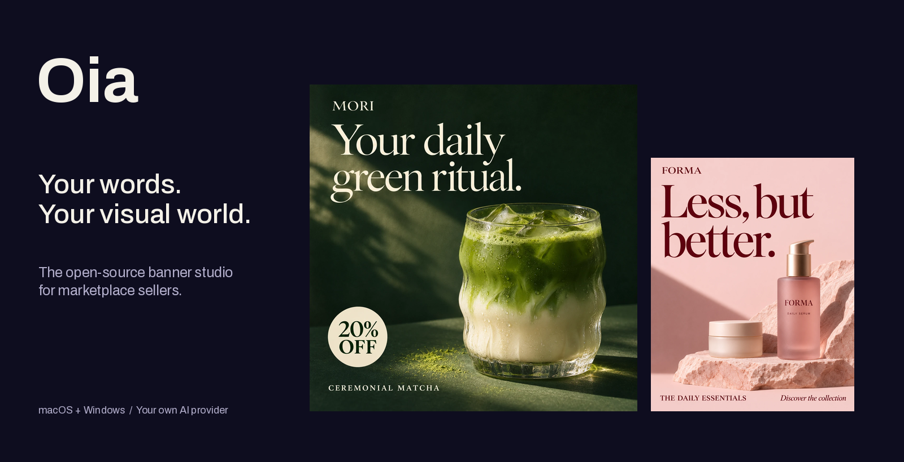
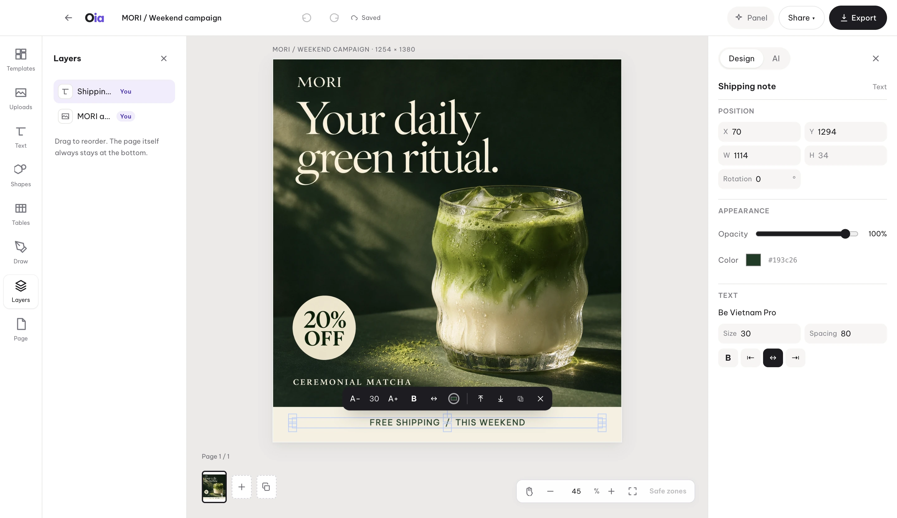
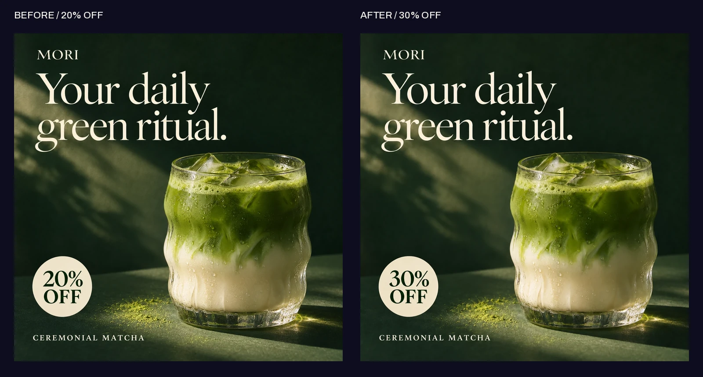

<p align="center">
  
</p>

# Oia

**A free, open-source banner studio for marketplace sellers.** Type a sentence, attach your product photo, and get a finished Shopee / Lazada / TikTok Shop banner, then change the price or the text without paying for a whole new design. Runs on your machine (macOS + Windows), on your own AI provider.

<p>
  <a href="https://github.com/cuongducle/oia/releases"></a>
  &nbsp;<a href="LICENSE"></a>
  &nbsp;
</p>

[Download](#download) · [What you get](#what-you-get) · [Providers](#bring-your-own-provider) · [Agent API](#agent-api) · [Build from source](#build-from-source) · [Landing page](https://oia.solutions/)

---

## Download

Ready-made installers live on the [releases page](https://github.com/cuongducle/oia/releases), no account, no signup.

| Build | File | For |
| :--- | :--- | :--- |
| macOS | `Oia-<version>-arm64.dmg` (~315 MB) | Apple Silicon (M1-M4), macOS 13+ |
| Windows | `Oia-<version>-win-x64.exe` (~280 MB) | Windows 10/11 64-bit, per-user install (no admin) |

Intel Mac: no build yet; [build from source](#build-from-source) works today.

The builds are unsigned (no signing budget yet), so the first open needs one extra click:

- **macOS:** right-click the app → **Open** → **Open** (or System Settings → Privacy & Security → **Open Anyway**). If macOS says the app "is damaged", run `xattr -d com.apple.quarantine /Applications/Oia.app`.
- **Windows:** SmartScreen shows "Windows protected your PC" → **More info** → **Run anyway**.

Step-by-step with screenshots-level detail: **[oia.solutions/install](https://oia.solutions/install/)**. There is no auto-update channel yet; pick up new versions from the releases page; your projects survive upgrades.

---

## What you get

<p>
  <a href="site/assets/studio.webp"></a>
  <br><sub><b>A real canvas, not a mockup.</b> The campaign lettering is baked into the image. The selected shipping note is a separate, editable text layer. Click for the full-size screenshot.</sub>
</p>

- **Banners with real typography, from one sentence**: describe the sale like a caption; research and auto-refine agent loops check facts and the rendered copy before you ever export. Every loop is priced before you run it.
- **A layer canvas, not a flat picture**: text, images, shapes and your uploads are separate objects. Move the headline without touching the photo; fix a price without regenerating. Outline edits and object edits cost zero images.
- **A studio template library**: flash sales, menu boards, product drops, posters, social posts, livestream overlays and more, in two design systems (Swiss & Editorial). Starting from a template costs zero images; publish your own back into the library.
- **Marketplace sizes built in**: Shopee / Lazada / TikTok Shop squares, TikTok 9:16, livestream overlays with safe zones, posters, decks, A4.
- **Export anywhere**: PNG, JPG, PDF (mixed page sizes), PPTX, ZIP of page images.

<p>
  
  <br><sub><b>Change the offer. Keep the visual direction.</b> Two real image outputs, one reference-image edit apart (about 1 image). Fine image details can change; repaint is not a pixel lock. MORI and FORMA are fictional campaign examples, not bundled-template previews.</sub>
</p>

### How a banner happens

1. **Describe it**: “matcha campaign, 20% off today”, pick a marketplace size. The full cost (`up to N images + N reads`) shows before you run.
2. **Approve the outline**: multi-page plans land as an outline first; editing it is free.
3. **Make it yours**: repaint by asking, or edit objects directly. AI edits show a preview first; you apply only what you keep. Your own layers are never deleted by AI refinement.
4. **Export**: marketplace sizes, overlays, decks; PDF/PPTX included.

### Text: baked by default, editable on demand

Generations render the copy into the artwork for the best-looking typography. Two paths keep text editable: flip **“Editable text right away”** before generating (clean-plate artwork + native text layers), or select any baked design and click **“Make text editable”** (rebuilds each line as a layer, ≈ 1 image + 1 read).

---

## Bring your own provider

| Role | Provider | Setup |
| :--- | :--- | :--- |
| Image | `codex` | Bundled Codex CLI + ChatGPT login (recommended, zero-setup) |
| Image | `openai` | `OPENAI_API_KEY` (generations and edits with reference images) |
| Image | `fal` | `FAL_KEY` |
| Image / planner | `mock` | Default; for testing the workflow, no credentials, no real artwork |
| Planner | `codex` | Same ChatGPT login, text-only `codex exec`, structured plan |
| Planner | `openai` | `OPENAI_API_KEY` |

A mixed mock/real pair (mock planner feeding a real image channel) refuses to boot, canned plans never ride a real generation channel silently.

**Local does not mean generation is free:** generations consume your ChatGPT plan allowance or bill through your own API account. Every action shows its price before it runs. Prompts and images go to the provider you configure.

For Vietnamese sellers the loop works end to end in Vietnamese: describe the banner in Vietnamese, the planner reads price/date/name out of the request, attach the real product photo as a reference image, export at marketplace sizes, the banner copy renders with full Vietnamese diacritics.

---

## Agent API

The desktop app runs a loopback HTTP API on `127.0.0.1` (random port) for coding agents:

1. Open the app → **For agents** → create an API key (shown once).
2. Set `OIA_BASE_URL` / `OIA_API_KEY`, or do nothing: the bundled skill scripts read the discovery file (`agent-api.json` in the app's user-data directory) themselves.

```bash
curl -X POST "$OIA_BASE_URL/api/tasks/generate-poster" \
  -H 'Content-Type: application/json' \
  -H "Authorization: Bearer ${OIA_API_KEY}" \
  -d '{"prompt":"A minimal coffee campaign poster"}'
```

Responses use a `{code, data, msg}` envelope; poll `GET /api/tasks/{id}` for the result (24-hour TTL). Quota is protected: one metered generation in flight, per-key rate limits, every agent job labeled in the app's job feed. Installable agent instructions live in [`packages/skills/skills`](packages/skills/skills).

---

## Build from source

Requires Node.js 22 and pnpm 10.

```bash
git clone https://github.com/cuongducle/oia.git
cd oia
pnpm install
pnpm exec turbo run build --filter='./packages/*'   # packages before apps
pnpm --filter @oia/desktop dev                      # run the desktop app

# gates
pnpm build && pnpm test && pnpm typecheck

# installers (build each platform on its own OS; unsigned)
pnpm --filter @oia/desktop dist:mac        # .dmg (fetches the pinned Codex CLI first)
pnpm --filter @oia/desktop dist:win        # NSIS .exe, per-user
```

```text
apps/desktop         Electron app: main + utility process, renderer (React), shared IPC contracts
packages/schema      Shared validation and scene schemas
packages/protocol    Stream decoder and message markers
packages/providers   Image and language-model adapters (CLI + process-host)
packages/agent       Planning and streamed scene generation
packages/canvas      Canvas utilities, page handling, export planning
packages/tasks       Task processing, stores, files, projects, templates
packages/services    Chat orchestration, quota, context
packages/skills      Coding-agent instructions (consumer of the loopback API)
site/                Landing page (static, no build step) → oia.solutions
```

---

## Contributing & limits

MIT license, explore the code, adapt the studio, and contribute through [issues](https://github.com/cuongducle/oia/issues) or pull requests. Verification notes for editor/export behavior live in [`docs/verification/`](docs/verification/).

Known boundaries, so nothing surprises you:

- **Artwork is raster**: object edits don't repaint pixels inside an image; reference-image support varies by provider.
- **Some tools are unfinished**: background removal needs `rembg`; PPT Translator is a placeholder.
- **Storage is local**: projects live in the app's data directory with atomic writes; there is no cloud sync (by design).
- **macOS builds are Apple Silicon only** for now.
