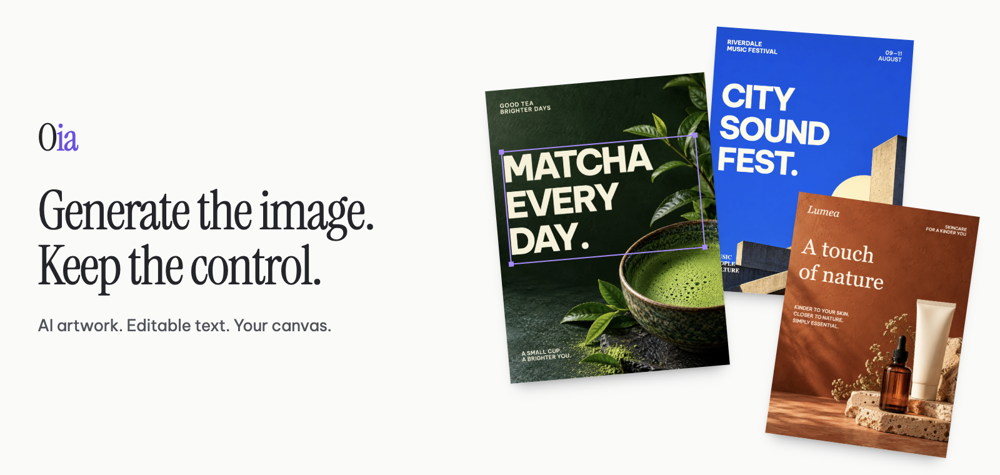
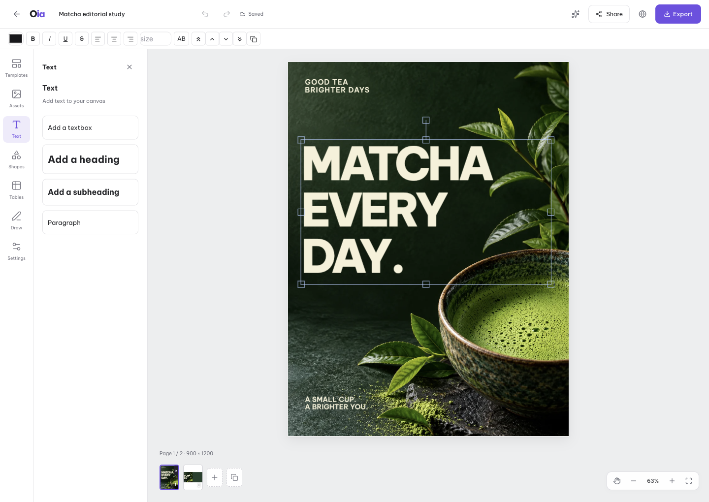

<p align="center">
  
</p>

<p align="center">
  <strong>Open image agent. Generate artwork. Edit the composition. Make it yours.</strong>
</p>

<p align="center">
  <a href="#quick-start">Quick start</a> ·
  <a href="#what-editable-actually-means">How layers work</a> ·
  <a href="#bring-your-own-provider">Providers</a> ·
  <a href="#build-it-into-your-workflow">API & agent skills</a> ·
  <a href="LICENSE">MIT license</a>
</p>

---

## Good images are a starting point. Finished designs need control.

A campaign headline changes. An event date moves. A client wants the logo larger. These are layout and copy edits—not reasons to generate a whole new image.

**Oia pairs AI image generation with a real, layer-based canvas.** Combine generated artwork with editable text, shapes, and your own assets. Refine the composition by hand, keep multiple pages in one project, and export the result without leaving the studio.

Run it on your own machine or server. Bring your own supported provider. Keep your projects under your control.

## What editable actually means

<p align="center">
  
  <br>
  <sub>Actual editor, bundled Matcha template. The selected headline is a text object—not lettering baked into the photograph.</sub>
</p>

**The image and the design are different things.** An Oia document contains separate canvas objects:

| Object | What you can change |
| :--- | :--- |
| **Text** | Rewrite copy, adjust size, weight, color, alignment, and spacing |
| **Images** | Move, resize, rotate, reorder, or replace artwork and uploaded assets |
| **Shapes & additions** | Add graphic elements, tables, drawings, and more text |
| **Artboard** | Set document dimensions independently for each page |

Move a native headline without moving the photograph. Fix its wording without calling an image model. Duplicate a page and adapt the copy for another placement. Undo changes and let autosave preserve the project.

> **Layers, not magic image decomposition.** Oia does not turn every object or letter inside a generated image into an editable layer. Generated scenes currently contain an artwork image and, when supplied by the planner, a separate copy textbox on the first page. Bundled templates include more deliberately composed text and shape objects. Text already embedded in the artwork remains pixels.

## A studio around your image model

### 01 — Generate a starting point

Describe the visual, choose dimensions and page count, and follow the streamed generation progress. Use a supported image provider for real artwork, or explore the editor with the keyless mock provider and bundled templates.

### 02 — Make the design yours

Edit native objects directly on the Fabric.js canvas. Add your own images and copy, adjust the stacking order, use undo/redo, and work across pages with different dimensions. Save projects locally through the app, reopen them, or publish an editable community template.

Brand Kit stores brand information; its written guidance is passed to the generation planner. It is a prompt aid, not a guarantee that every font, logo, or color will be applied automatically.

### 03 — Take it into production

Export **PNG, JPG, PDF, PPTX, or a ZIP of page images**. PDF preserves mixed page sizes. PPTX places rendered artwork on slides; it does **not** convert canvas layers into native PowerPoint text and shapes.

The Toolbox also brings together format conversion, image resizing, chart creation, and provider-backed image tasks.

## When to use this instead of an image chat

**Use an image chat when the image itself is the deliverable. Use Oia when you also need to assemble, revise, and reuse a design.** It adds a workflow around image models—not a claim of a better underlying model.

| Your task | With an image-only result | With Oia |
| :--- | :--- | :--- |
| Change a headline or event date | Edit the image or regenerate it | Edit the native textbox, if the copy is a separate layer |
| Move a logo or adjust a composition | Open a separate editor | Work on canvas objects in the same studio |
| Organize a multi-page project | Manage separate outputs | Keep pages, dimensions, and revisions in one project |
| Reuse a layout | Rebuild it or reuse a flattened image | Save and share an editable scene as a template |
| Deliver files | Convert and assemble them elsewhere | Export images, PDF, PPTX, and ZIP from the editor |
| Automate recurring tasks | Depends on the service and its API | Use the self-hosted task API and coding-agent skills |

**Non-destruction guarantee:** AI refinement never deletes your own layers. Objects you add (uploads, product photos, hand-placed text, tables) are stamped `origin: "user"` and survive every AI refinement on top of the regenerated scene — position intact. Layer objects without provenance (legacy projects) default to the same protection. Removing them is a manual, explicit act.

## Quick start

**Requirements:** Node.js 22 and pnpm 10. No provider key, PostgreSQL, or Redis is needed to explore the default local setup.

```bash
git clone https://github.com/cuongducle/oia.git
cd oia
pnpm install

# Build the workspace packages before starting the web app.
pnpm exec turbo run build --filter='./packages/*'
pnpm --filter @oia/web dev
```

Open **[localhost:3100](http://localhost:3100)**. Start with a bundled template to try real text and object editing. The default mock provider is for testing the workflow; it does not generate production AI artwork.

## Bring your own provider

For the web app, copy the example configuration into Next.js's local environment file, then edit it and restart the server:

```bash
cp .env.example apps/web/.env.local
```

The **current provider registry** implements:

| Role | Provider | Setup |
| :--- | :--- | :--- |
| Image | `mock` | Default; no credentials (labeled **“Chế độ thử nghiệm”** in the UI) |
| Image | `codex` | Installed Codex CLI with image generation available and an authenticated ChatGPT login |
| Image | `openai` | `OPENAI_API_KEY` (generations **and** edits with reference images; one pinned model) |
| Image | `fal` | `FAL_KEY` |
| Planner | `mock` | Default; no credentials |
| Planner | `codex` | Same Codex login — text-only `codex exec`, structured plan, no API key |
| Planner | `openai` | `OPENAI_API_KEY` |

A mixed mock/real pair (for example a mock planner feeding the real Codex image channel) **refuses to boot** — canned planner output never rides a real generation channel silently.

For example, to use your existing Codex login for **both** roles (the recommended keyless pair — one login, one channel, two uses):

```bash
codex login
IMAGE_PROVIDER=codex LLM_PROVIDER=codex pnpm --filter @oia/web dev
```

For Vietnamese sellers this enables the banner loop end to end: describe the banner in Vietnamese → the planner reads price/date/name out of the request (editable text blocks, font Be Vietnam Pro) → clean-plate artwork (no baked text) is generated through your ChatGPT plan quota → attach the real product photo as a **reference image** (`codex exec -i`) so the scene is built around the actual product → export at marketplace sizes (Shopee / Lazada / TikTok Shop presets).

Codex image generation depends on CLI support and account access, and consumes the applicable account allowance. Other paid providers bill through your own account. **Self-hosted does not mean generation is free.** Provider names beyond the implemented registry should not be treated as working integrations.

## Build it into your workflow

Submit tasks from a script, another app, or a coding agent. Create a key in **For Agents** and set `OIA_REQUIRE_KEY=1` to enforce keys on the guarded task endpoints.

```bash
curl -X POST http://localhost:3100/api/tasks/generate-poster \
  -H 'Content-Type: application/json' \
  -H "Authorization: ${OIA_API_KEY}" \
  -d '{"prompt":"A minimal coffee campaign poster"}'
```

The default submission returns a task ID; poll `GET /api/tasks/{taskId}` for the result. Responses use a `{code, data, msg}` envelope. Task records have a 24-hour TTL.

Installable instructions for coding agents live in [`packages/skills/skills`](packages/skills/skills). Configure `OIA_BASE_URL` and `OIA_API_KEY` for your instance.

<details>
<summary><strong>Development, tests, and project structure</strong></summary>

```bash
pnpm build
pnpm typecheck
pnpm test

# Include real Redis-backed integration tests when Redis is available.
docker compose -f docker/docker-compose.yml up -d redis
REDIS_URL=redis://localhost:6379 pnpm exec turbo run test --force
```

The repository includes unit and integration coverage for the editor utilities, stream protocol, providers, task processing, persistence, and worker flows. See [browser verification notes](docs/design/verification.md) for the recorded editor and export checks.

```text
apps/web            Next.js studio, Fabric editor, REST and SSE endpoints
apps/worker         Background worker
packages/agent      Planning and streamed scene generation
packages/canvas     Canvas utilities, page handling, and export planning
packages/providers  Image and language-model adapters
packages/protocol   Stream decoder and message markers
packages/schema     Shared validation and scene schemas
packages/tasks      Task processing, files, projects, and templates
packages/db         Database schema definitions
packages/skills     Coding-agent instructions
```

</details>

## Desktop direction (in progress)

The product direction is a shared **macOS and Windows desktop app**, with a public website for product information and downloads. The [design](docs/designs/desktop-app.md) is approved (owner gates Q1–Q10, 2026-10-30); shipped so far:

- `apps/desktop` — Electron + electron-vite shell with a typed, zod-validated IPC surface over the same service layer (`@oia/services`) the web app uses; banner Home flow with clean-plate toggle, stop control, Vietnamese error map, and a canvas preview served by a custom `oia://files` asset protocol (no HTTP server needed).
- **In-app Codex runtime (D3 increment 1)** — a runtime panel manages the engine with zero terminal use: detect (PATH/well-known/managed) → guided download of the official checksummed `codex-package-<target>.tar.gz` (sha256 verified against the published sums, recoverable swap) → in-app ChatGPT login (origin-checked auth URL, opened in the system browser, shown copyable as fallback) → provider-mode switch (auto/codex/mock) that rebuilds the context without a restart. Auto picks Codex only after you act through the panel (install/login/explicit choice) — a pre-installed codex never auto-bills your quota. CI smoke stays mock.
- Verified end to end on macOS with a scripted real-window check (`OIA_DESKTOP_SHOT`) and a CI `desktop-smoke` job (xvfb). The chat loop runs keyless (mock pair) or against the owner's Codex login, exactly like the web shell.

**Desktop installers are not available yet.** Remaining slices: the full renderer port (editor, templates), install-and-upgrade persistence (schemaVersion, per-project files, `.data` import), Windows verification (physical-machine gate), and signed auto-updates. The setup instructions above describe the current self-hosted web implementation.

## Deployment & current boundaries

- **Designed for a trusted self-hosted environment.** API-key checks on guarded routes are not a complete, application-wide authentication system. Put the app behind access control before exposing it publicly.
- **Local storage by default.** Project and asset persistence uses the app's local data directory. Use a persistent volume or set `OIA_DATA_DIR`; back it up before upgrading.
- **Artwork remains raster.** Object-level canvas edits do not edit pixels inside the underlying image. Reference-image support also varies by provider.
- **Some tools need extra setup or are unfinished.** Background removal requires `rembg`. PPT Translator is coming soon; the image-translation task is not implemented.
- **Your provider remains involved.** Prompts and images used for generation go to the configured provider. Running the studio locally does not make external model calls private to your machine.

## Open source

Oia is released under the [MIT license](LICENSE). Explore the code, adapt the studio to your workflow, and contribute through [issues](https://github.com/cuongducle/oia/issues) or pull requests.
