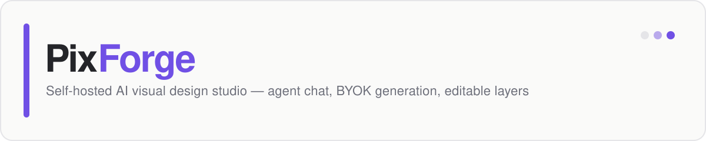
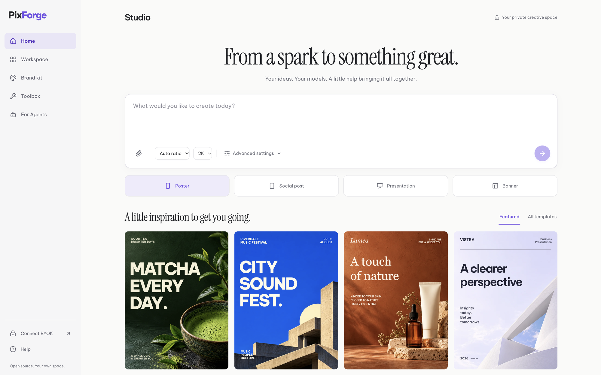
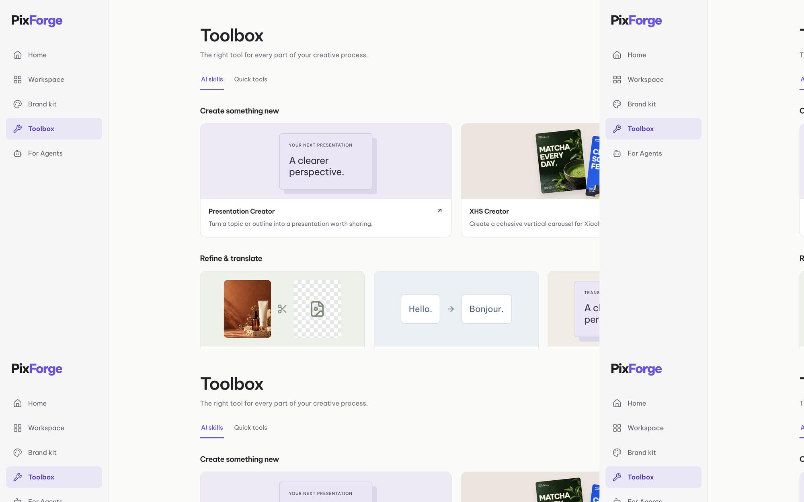

<p align="center">
  
</p>

<p align="center">
  <a href="LICENSE"></a>
  
  
  
  
</p>

PixForge is an open-source, self-hostable AI visual design studio. Describe what you want, watch the agent compose it live, then edit every layer yourself — posters, presentations, social posts, and more. Your keys, your server, your data.

<p align="center">
  
</p>

<table>
  <tr>
    <td width="50%"></td>
    <td width="50%"></td>
  </tr>
</table>

## Highlights

| | |
| --- | --- |
| **Agent chat → design** | Streaming SSE agent (`Designer Agent → Image Generator → Manager Agent`) with a live task timeline and progressive canvas updates |
| **Truly editable output** | Every design lands as a layered Fabric.js scene — move, restyle, and retype anything; nothing is a flattened image |
| **Real editor** | Multi-page projects, undo/redo, autosave, sharing, zoom/pan, text and shape tools, artboard presets |
| **Export anywhere** | PNG · JPG · PDF (mixed page sizes) · PPTX · ZIP |
| **BYOK generation** | `mock` · `codex` (your ChatGPT login, no API key) · `openai` · `fal` · `replicate` · `comfyui` |
| **For agents too** | HTTP API with API keys plus installable `SKILL.md` skills for Claude Code, Codex, Cursor, Gemini CLI |

Also included: a Toolbox of quick tools (converters, resizer, charts, AI editor, Xiaohongshu/RED carousel creator), a Brand Kit applied to every generation, and community templates.

## Quick start

```bash
pnpm install
pnpm dev            # http://localhost:3100 — mock provider, no keys needed
```

Optional Redis for the background worker:

```bash
docker compose -f docker/docker-compose.yml up -d redis
REDIS_URL=redis://localhost:6379 pnpm --filter @pixforge/worker dev
```

Tests (integration tests use Redis when available):

```bash
pnpm build && pnpm typecheck
REDIS_URL=redis://localhost:6379 pnpm test
```

## Bring your own keys

Copy `.env.example` to `.env` and fill in what you have — leave it blank to keep the offline mock provider.

| Variable | Options |
| --- | --- |
| `IMAGE_PROVIDER` | `mock` (default) · `codex` · `openai` · `fal` · `replicate` · `comfyui` |
| `LLM_PROVIDER` | `mock` (default) · `openai` · `openrouter` · `ollama` |

**Image generation without an API key:** run `codex login` once (Sign in with ChatGPT), set `IMAGE_PROVIDER=codex` — generation runs through the Codex CLI's `$imagegen` on your existing plan quota.

## Self-host API & agent skills

```bash
pnpm --filter @pixforge/web dev
# Create a key at http://localhost:3100/for-agents
curl -X POST localhost:3100/api/tasks/generate-poster \
  -H 'content-type: application/json' \
  -d '{"prompt":"pastel coffee poster","noWait":true}'
```

- Responses use a `{code, data, msg}` envelope; poll `GET /api/tasks/{taskId}` (24h TTL)
- Chunked upload: `POST /api/upload/chunk-init → /chunk → /chunk-complete`
- Set `PIXFORGE_REQUIRE_KEY=1` in production to require `authorization: pf-…`
- Skills in `packages/skills/skills/pixforge-*` — copy into `~/.claude/skills/` (or your agent's directory) and set `PIXFORGE_BASE_URL` + `PIXFORGE_API_KEY`

## Monorepo layout

```
apps/web            Next.js app — studio UI, editor, REST + SSE API
apps/worker         background task worker (BullMQ / in-process)
packages/schema     zod schemas: scene graph, SSE protocol, task types
packages/protocol   SSE decoder + [[task::]]/[[canvas::]] markers + golden fixture
packages/canvas     Fabric wrapper, editor presets, pages, export planner
packages/providers  BYOK adapters: image (mock/codex/openai/fal/…) · llm (mock/openai/…)
packages/agent      designer agent: planner → image tool → progressive canvas events
packages/tasks      task store, queue (BullMQ), processors, uploads, projects, templates
packages/db         drizzle schema (users/sessions/projects/brandkits/templates/api_keys)
packages/skills     SKILL.md agent skills
docker/             postgres + redis + minio compose files
docs/               design direction and verification notes
```

## Status

The editor, generation pipeline, exports, quick tools, brand kit, and agent API are implemented and tested (152 tests, including real Redis worker runs and an authenticated Codex image integration). Background removal requires the `rembg` CLI. PPT Translator is a coming-soon landing page. Multilingual generation follows your prompt's language; the interface is English.

MIT licensed. See [LICENSE](LICENSE).
