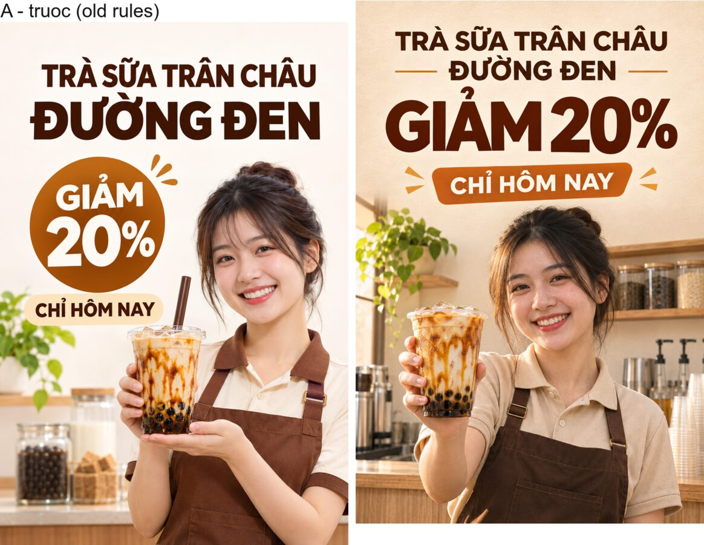
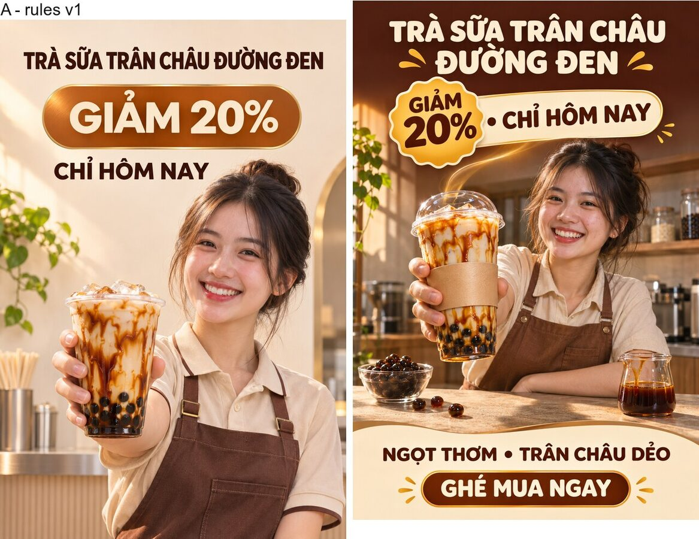
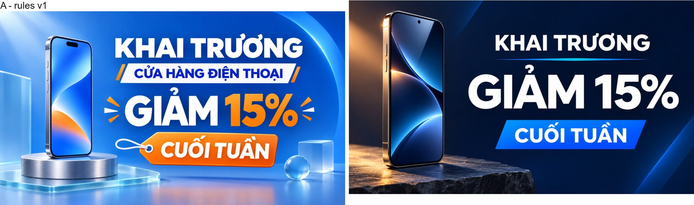

# Nghiên cứu prompt tạo ảnh: Evidence & bài học (2026-11-05)

Nghiên cứu phục vụ DA-11 (anti-"AI slop" craft rules) trong
[`docs/designs/designer-agent-loop.md`](../designs/designer-agent-loop.md).
Mọi luật được áp vào code đều trích nguồn primary ở đây; những gì bị loại
cũng ghi kèm lý do. Tiêu chuẩn evidence: thread/forum thật (username + URL),
tài liệu chính thức của vendor, paper có benchmark, hoặc thí nghiệm có kiểm soát.
Không dùng blog tổng hợp kiểu content-farm làm cơ sở quyết định.

Áp dụng cho: Oia gen ảnh qua `codex exec $imagegen` (họ GPT Image),
planner là LLM text sinh `imagePrompt`, critic là vision model chấm kết quả.

---

## Vòng 1: Repo OSideMedia/higgsfield-ai-prompt-skill (9 file ảnh tĩnh)

Nguồn: https://github.com/OSideMedia/higgsfield-ai-prompt-skill (MIT).
Đã đọc: root `SKILL.md`, `skills/higgsfield-prompt/SKILL.md`,
`skills/shared/negative-constraints.md`, `vocab.md`, `prompt-examples.md`,
`image-models.md`, `skills/higgsfield-style/SKILL.md`,
`skills/higgsfield-gpt-image-2/SKILL.md`, `skills/higgsfield-image-shots/SKILL.md`.
(Bỏ có chủ đích: các skill video, camera/motion/seedance/FACS/soul, Oia chỉ gen ảnh tĩnh.)

### Luật rút ra (kèm mục trong repo)

| Luật | Nguồn cụ thể |
|---|---|
| Cấm slop word (beautiful/stunning/cinematic/4K trần), thay bằng named referent | higgsfield-prompt § Anti-Slop Vocabulary: *"generic adjectives… pull the output toward nothing in particular; a director name, a lighting setup, or a lens spec samples a narrow, well-trained distribution"* |
| "Cinematic Does Nothing", mọi output mặc định đã cinematic | higgsfield-style § Style Best Practices |
| LUÔN nêu lighting: nguồn + hướng + chất lượng, *"No lighting specification → model defaults to even, generic lighting"* | negative-constraints § Texture/Lighting Artifacts (lỗi số 1 của họ) |
| Scene-physics lighting: vị trí nguồn + bounce + hình học bóng | vocab § Lighting Vocabulary |
| CGI Material Contract: 2-4 thuộc tính/surface (base + roughness + imperfection + edge), *"default sheen is plastic"* | higgsfield-style § CGI Material Contract |
| One Style Anchor: 1 anchor + tối đa 2 token, *"beyond 2-3 style tokens, model attention dilutes and the output becomes generic"* | higgsfield-style § One Style Anchor Rule |
| 60/30/10 palette | vocab § Color rules |
| Shot size + angle cho ảnh có subject | higgsfield-image-shots, công thức `[Shot size]+[Angle]+[Movement] of [subject]…[Lighting]…[Style]` |
| Depth-of-field nêu mặt phẳng giữ nét (2 dạng thay "no blur") | negative-constraints § Depth of field |
| Imperfection thuộc subject, không thuộc rendering (cấm bare "film grain"/"soft focus") | negative-constraints § Whole-Frame Degradation |
| Constraint viết khẳng định (không negative prompt slot) | negative-constraints § Cinema Studio 3.0 Notes |
| Tránh "photorealistic" khi có mặt người, họ GPT Image *"turn plasticky on realism-flagged prompts"*; frame thành film photography (35mm, grain, flash) | higgsfield-gpt-image-2 § 1 |
| Format taxonomy: layout-dense → structured (JSON theo vùng); single-scene → prose đậm; theme-only → meta-prompt | higgsfield-gpt-image-2 § 2-6, chưa áp dụng (follow-up) |
| Test "can a camera measure this?" | prompt-examples § Before→After |
| Batch-and-select + phân loại miss stochastic/systematic trước khi sửa prompt | higgsfield-prompt § Before You Iterate; production-benchmarks (image acceptance ~1%) |

## Vòng 2: Diễn đàn tiếng Anh (5 nguồn primary)

1. **OpenAI Cookbook, GPT Image prompting guide**
   https://developers.openai.com/cookbook/examples/multimodal/image-gen-models-prompting-guide
   - Cấu trúc: *scene → subject → key details → constraints* + nêu intended use để set "mode"
   - *"include the word 'photorealistic' directly… to strongly engage photorealistic mode"* (xem § Mâu thuẫn)
   - Ad = creative brief: *"describe the brand, audience, culture, concept, and exact copy, then let the model make taste-driven decisions"*
   - Text: quotes + typography + "no extra text"; iterate single-change
   - Person compositing: *"look like a real photograph someone could have taken… Avoid cinematic lighting, dramatic color grading"*, xác nhận lần 2 "cinematic" là từ slop
2. **OpenAI docs, Image prompting guide**
   https://developers.openai.com/api/docs/guides/image-prompting
   - *"Specify the composition, aspect ratio, and important placement constraints"*, khổ + bố cục + ràng buộc vị trí luôn đi bộ ba
3. **r/ChatGPT, GPT Image 2.5 prompt guide (8 rules, nén từ guide chính thức)**
   https://www.reddit.com/r/ChatGPT/comments/1wcatvx/
   - *"Name the deliverable first… The model picks composition defaults from that word"*
   - *"Camera and lens words are hints about the look, not a physics engine"*
   - *"For people, say framing, gaze and hands"*; *"Text goes in quotes with a position and a typeface"*
   - *"The quality step fixes more spelling than another adjective does"*
4. **community.openai.com, master threads**
   - DALL-E3/gpt-image-1 tips (112k views): https://community.openai.com/t/498040
   - GPT-4o-images collection (Daller): https://community.openai.com/t/1201440, memory giữa các lần gen, ảnh quá tối, post-processing tạo texture giả
5. **r/midjourney, 10 product prompts sau 1000+ test**
   https://www.reddit.com/r/midjourney/comments/1pjcivc/
   - Mỗi prompt đều: surface đặt tên (marble/velvet/rustic wood) + lighting đặt tên (soft diffused/morning sunlight/dramatic spotlight)
   - Comment đắt: *"Fast + cheap AI product shots → usually average. Accurate, brand-safe images → references + tight constraints"*

## Vòng 2: Cộng đồng Trung Quốc (3 nguồn primary)

1. **@xpg0970, 6 phương pháp xóa "塑料感" (cảm giác nhựa)**
   https://x.com/xpg0970/article/2047244398618882550 (2026-04)
   - Da: mô tả *sờ* (porous/rough), không *trông* (shiny): `biological skin texture`, `uneven skin tone`, `fine peach fuzz`; bỏ từ 2023 (`soft skin`, `8k`)
   - **Nhân-quả ánh sáng**: ❌ `Sunlight, wall` → ✅ `Harsh sunlight casting sharp shadows of the window frame onto the peeling wall`, *"dùng động từ nối danh từ: casting, reflecting, blocking, filtering through"*
   - **"Không khí không được chân không"**: dust motes/haze/Tyndall, *"chỉ viết ánh sáng mà không viết bụi → cột sáng như vẽ sau"*
   - **Lens flaw liều nhỏ**: vignette + halation → não đọc là "ảnh chụp"; *"điểm đến là đủ, thừa thành gượng"*
   - Tiêu đề: *"破碎的真空感"*, AI quá sạch là lỗi, không phải đức tính
2. **xiaohu.ai, Khung xương poster 40/45/15**
   https://xiaohu.ai/article/sellable-commercial-poster (2026-05, phân tích prompt viral @Diplomeme)
   - Chẩn đoán: *"你给它形容词，它给你图库；你给它施工图，它给你海报"*, cho tính từ nhận ảnh stock, cho bản vẽ thi công nhận poster
   - Khung xương: top 40% typography (7 phần tử: logo, headline split-color + tight kerning, subheadline trên dải nét cọ, support line, lớp chữ nền 10-15% opacity, badge, thẻ giấy); middle 45% **sân khấu** sản phẩm (không close-up; container + phụ liệu + yếu tố động nối); bottom 15% CTA
   - Nêu đủ 4 loại sáng: key/fill/underlight/rim, *"không nêu đủ 4 loại,画面扁 (ảnh phẳng)"*
   - **Negative prompt không copy nguyên**: *"无杂乱" nhưng 5/5 ảnh output đều dày thông tin, lệnh cấm thật ra là 'cho phép có kiểm soát'"; viết *"information-dense but grid-aligned"* thay *"no clutter"*, *"lệnh cấm thật luôn đi theo phong cách"*
   - 2% grain: chuyển cảm giác "ảnh màn hình" → "poster giấy"
3. **Zhihu, 3 kỹ thuật xóa "AI味" (vị AI)** + **Xiaohongshu 3:4 cover**
   https://zhuanlan.zhihu.com/p/2054517785917760150 (2026-07)
   https://zhuanlan.zhihu.com/p/2038338031539729054 (2026-05, dẫn流量白皮书 XHS 3/2026)
   - Đừng堆 8K/超清, thêm "vết lỗi" chủ đích: "轻微胶片颗粒 + 自然肤质"
   - *"给光一个方向"*, có hướng là có立 thể; foreground遮挡 → não补全 "đang nhìn xuyên qua"
   - XHS: 3:4 dọc là "tấm vé vào cửa traffic" (1242×1660); người giữa + trống trên cho tiêu đề; chữ ≥36pt có viền, không "蚂蚁字" (chữ kiến), không đè mặt; XHS **nhận diện + hạ traffic** ảnh thuần AI → noise/sharpen hậu kỳ

## Vòng 3: Prompt theo khổ ảnh

- **community.openai.com, ảnh dọc gen ra ngang** (10k views, 2023→2025):
  https://community.openai.com/t/481903, ghi `"vertical image"` không hiệu quả;
  cái hiệu: từ *"portrait/landscape"* + mô tả cảnh theo trục dọc (*"towering over the viewer", "perspective from below", "tall"*)
- **TikTok Effect House (chính thức)**: *"The order of words matters, words placed earlier in the prompt have a greater influence on the final image"*
- **Google Gemini support**: chọn khổ trong setting không đủ, *"add text describing the format in the prompt"*
- Quy tắc tổng hợp: dọc = stack trên-dưới + full-length subject; ngang = flow trái-phải; khổ mô tả bằng NGÔN NGỮ BỐ CỤC, không chỉ con số; placement constraint đi kèm khổ

## Vòng 3: Sáu chủ đề sâu

### #2 Refine bằng edit hay regenerate (thí nghiệm có kiểm soát)
- **astorie.ai** https://astorie.ai/blog/gpt-image-2-5-editing-drift (10/2026, GPT Image 2.5, 3 đường cùng 5 sửa đổi):
  edit nối chuỗi → mất texture ngay từ edit đầu (dù prompt kiểm soát); prompt chi tiết khống chế semantic drift nhưng KHÔNG chặn texture drift;
  **single-pass từ bản gốc sạch** (gộp hết revision list vào 1 edit) → sắc nét nhất.
  Quy tắc: serial khi đang khám phá; biết full list → rebuild single-pass.
- **community.openai.com** https://community.openai.com/t/1392634 (8/2026, pain thật, user xin refund):
  *"I've tried 'Do not change anything else', 'Preserve the existing image exactly'… It still drifts"*;
  *"I don't need the AI to be more creative. I need it to be more faithful."*
- **Artificial Analysis, 30 edits benchmark**: drift là vấn đề xuyên model. https://alphasignal.ai/news/artificial-analysis-runs-30-edits-to-expose-how-image-models-drift
- **Hàm ý Oia:** vòng refine hiện tại (sửa prompt → regenerate) chính là "single-pass rebuild", ĐÚNG theo evidence. Follow-up: nhánh surgical-edit chỉ cho lỗi cục bộ nhỏ.

### #3 Product photo → scene mới
- Cookbook: gán vai từng ảnh (*"Image 1: product photo…"*); try-on pattern:
  *"Match lighting, shadows, and color temperature… so the outfit integrates photorealistically, without looking pasted on"*;
  cutout: *"Preserve product geometry and label legibility exactly"*
- masonry.so: *"Lock an approved source, a packshot that has already passed your normal review process"*
- photta.app: chụp ảnh nguồn như chụp tài liệu, thẳng, đủ sáng, label đầy khung, full resolution
- **Đã vá:** `referenceClauses` +1 câu integrate lighting/shadow/color temperature.

### #4 Thứ tự từ
- TikTok Effect House (chính thức): từ đầu nặng ký hơn, https://effecthouse.tiktok.com/learn/guides/ai-capabilities/ai-editor/how-to-write-prompts-for-ai-generation
- Higgsfield: *"Subject + Action in the first 20-30 words, early tokens carry disproportionate weight"*
- CSDN即梦: *"主体放最前，越靠前权重越高"*
- **Đã vá:** bullet front-load vào IMAGE_CRAFT_RULES.

### #5 Nhãn AI của Meta (rủi ro phân phối cho seller)
- **Meta Business Help (chính thức)**: https://www.facebook.com/business/help/1010479435004531, tự dán "AI info" khi phát hiện metadata C2PA từ công cụ bên thứ 3; self-disclosure chỉ áp EU/California/New York/India/Taiwan (**VN ngoài danh sách**); bắt buộc riêng ads chủ đề xã hội-bầu cử.
- auditsocials (5/2026): Meta đọc IPTC, industry chạy C2PA, hai chuẩn không tương thích hoàn toàn.
- **Kết luận cho Oia:** ảnh render lại qua canvas → mất C2PA → banner không bị dán nhãn tự động; không có bằng chứng nhãn làm giảm reach (khác XHS có hạ traffic thật). Không cần hành động.

### #6 Palette lock (paper phản bác folklore hex)
- **arXiv 2603.13547, NumColor/GenColorBench** https://arxiv.org/html/2603.13547v1:
  baseline T2I gần như bất lực với hex/RGB, FLUX 13,8% đúng màu coarse (random 7,7%);
  nguyên nhân: *"hex codes fragment into character tokens"* → rainbow artifacts.
- r/eCommerceSEO: hex chỉ 1/3 bộ ba, hex + **reference image** + *"match these colors exactly, no shifting"*
- Higgsfield Soul HEX: khóa màu bằng ảnh tham chiếu, không phải text.
- **Đã áp:** palette 60/30/10 bằng TÊN màu trong IMAGE_CRAFT_RULES; multi-page lặp nguyên văn ngôn ngữ màu (kế thừa từ Higgsfield "repeat exact color language").

### #7 Batch-and-select (best-of-N)
- Nhiếp ảnh chuyên nghiệp làm best-of-N cả trăm năm: burst → cull (Aftershoot 10/2026:
  *"groups similar frames, scores faces for expression, blinks and focus, autocull best of each group"*)
- Higgsfield production-benchmarks: image acceptance ~1% ở production 90 phút → batch + cull rubric (hard-gate invariant trước, chấm trục đang fail, log rejects)
- Cookbook: `n=4` chính thức cho logo variations
- **Follow-up Oia:** phân loại miss stochastic (giữ prompt, roll thêm) vs systematic (sửa prompt) trước khi refine; tùy chọn batch n=2-3.

---

## Mâu thuẫn giữa các nguồn & cách xử lý

| Mâu thuẫn | Phe A | Phe B | Quyết định cho Oia |
|---|---|---|---|
| "photorealistic" | Cookbook: ghi thẳng để bật mode | Higgsfield (cho đúng họ GPT Image): tránh khi có mặt người → plastic skin | Cấm chỉ khi có người (frame thành film photography); cho phép khi không có người. A/B 05-11 xác nhận bản thắng ghi "35mm film photograph" |
| film grain | Higgsfield: cấm grain trần (whole-frame degradation) | TQ: 2% grain + halation tăng cảm giác thật | Không mâu thuẫn thật: cấm grain *rời rạc như quality plea*; cho phép *có liều lượng + gắn chất cụ thể* (look choice hợp lệ) |
| Hex color | Blog thương mại: "include hex codes" | arXiv: hex fragment, ~14% đúng | Palette bằng tên màu; hex không đáng tin; khóa tuyệt đối = ảnh tham chiếu |
| Thứ tự tối ưu | Higgsfield: Subject→Action→Camera→Style | Cookbook: scene→subject→details | Không xung đột thực tế: cả hai dồn load-bearing về đầu; Oia chốt deliverable → subject → chi tiết → constraints |

## Trạng thái áp dụng vào code (2026-11-05)

- `IMAGE_CRAFT_RULES` (`packages/schema/src/plan.ts`), 15 luật, mọi luật có nguồn ở trên
- Poster mode khổ-aware (`packages/agent/src/designer.ts`), orientation bằng ngôn ngữ layout + khung xương vùng 40/45/15 (dọc) / flow trái-phải (ngang)
- `referenceClauses` (`packages/providers/src/image/codex.ts`), thêm câu integrate lighting chống "pasted on"
- Quyết định + follow-up ghi trong DA-11 (`docs/designs/designer-agent-loop.md`)

A/B thực nghiệm ghi nhận: bản rules v1 (12 luật) thắng blind-review 7/10 vs 5,5/10 so với không rules (05-11, n=1 mỗi bên, bằng chứng định hướng, khớp cơ chế từng luật).

## Kết quả A/B blind: ảnh bằng chứng

Mỗi cặp cùng user prompt, cùng model planner, chỉ khác planner system prompt.
Judge là vision model KHÔNG biết bên nào là bản mới (blind, đúng thứ tự mà critic
DA-8 sẽ chấm khi Auto refine bật). Prompt đầy đủ của từng ảnh: [`ab-prompts.md`](ab-prompts.md).

### Vòng 1: không rules (A) vs IMAGE_CRAFT_RULES v1 (B)

Verdict blind: **B thắng rõ 7/10 vs 5,5/10**. Judge gọi A là “flat, frontal,
ring-light-style illumination… wax figure finish”; khen B đúng các trục luật dạy,
key light có hướng (luật lighting), flyaway hair + skin micro-detail (luật skin),
“one palette, three values” (luật 60/30/10), “GIẢM 20% as the undisputed hero”
(khung hierarch). Chữ tiếng Việt đúng dấu cả hai bên.

### Vòng 2: rules v1 (A) vs v2 (+ orientation language + zone skeleton): dọc

Verdict blind: **B thắng rõ 8,5/10 vs 6/10**. Judge: A là “a lifestyle stock photo
with text stamped on top, no CTA, no feature line”; B có đủ 5 zone
(headline → offer → product → benefits → CTA, đúng khung 40/45/15) và dải khói
vàng nối ly trà lên badge bị khen “smart connective device”, chính “dynamic
element connecting the zones” trong instruction.

### Vòng 2: v1 (A) vs v2 (B): ngang (đường landscape flow)

Verdict blind: **B thắng clear về craft**: “heavy product anchor on the left
third, right-aligned copy stack, eye sweeps left-to-right” (đúng flow trái-phải
được dạy); A bị chấm “the eye zigzags… looks like a template”. Đánh giá trung
thực kèm: A giữ được điểm thương mại (dòng “CỬA HÀNG ĐIỆN THOẠI” + accent màu
cho offer), v2 thắng craft, chưa chắc thắng thông điệp; n=1 mỗi bên.

